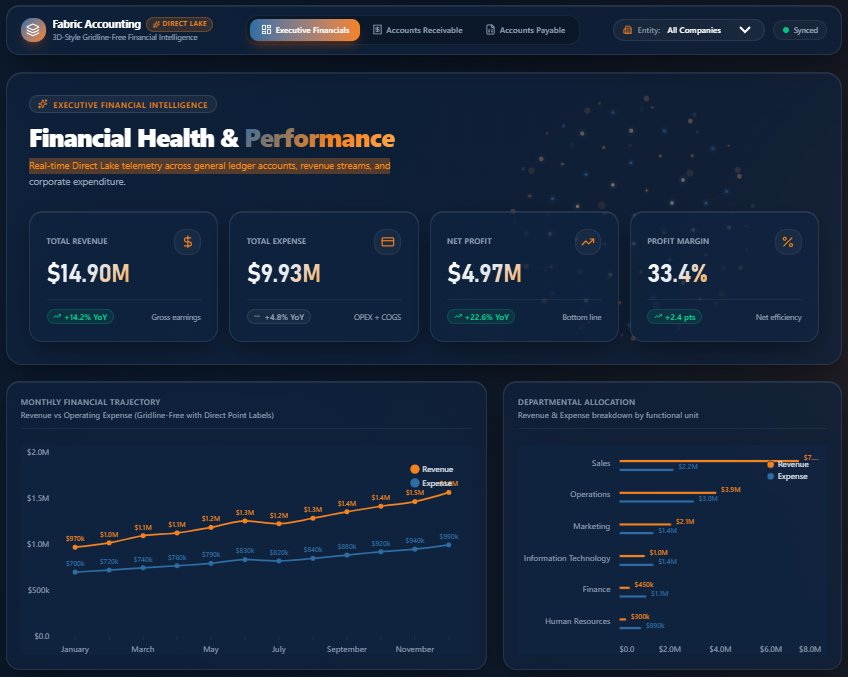
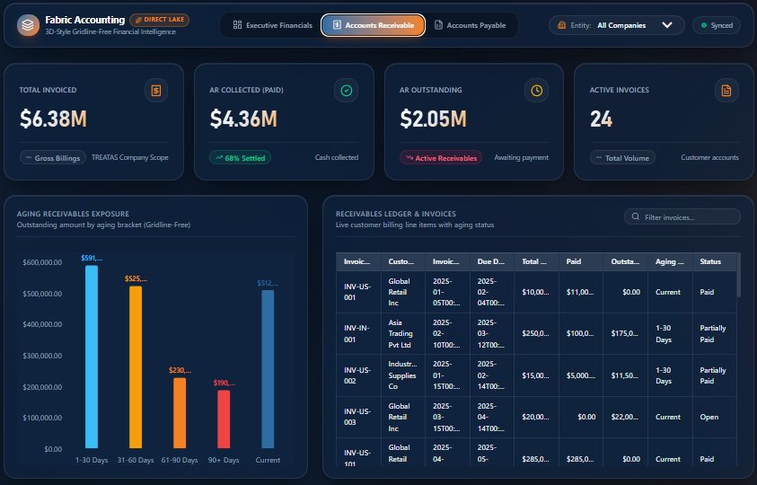
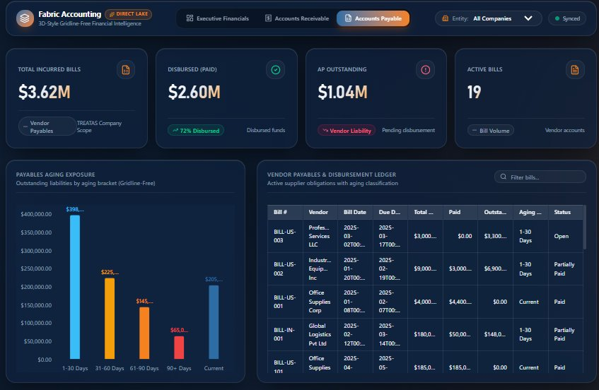
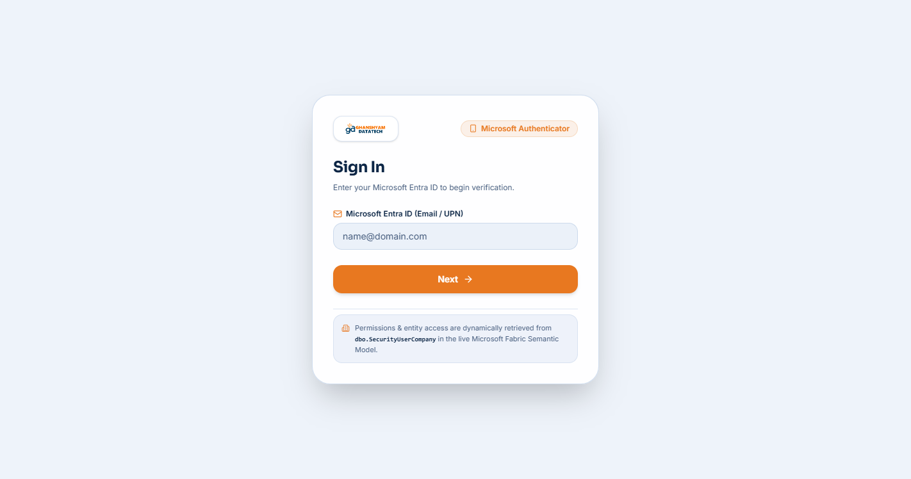

# Fabric Apps Export (`App Fabric`)

Complete export of the **database**, **semantic model**, **backend configuration**, and **frontend bundles** from the Microsoft Fabric workspace **`Fabric Apps`**, centered on the **`App Fabric`** financial analytics application.

---

## Architecture Overview

```text
Gold_FabricApp.Warehouse (OneLake Delta Tables + T-SQL)
        │  DirectLake
        ▼
Fabric App SM.SemanticModel (TMDL + Finance_RLS)
        │  Fabric Portal / BaaS Auth (rayfin.yml)
        ▼
App Fabric.AppBackend (Static React + Vega-Lite Frontend)
```

---

## Repository Structure

```text
.
├── docs/
│   └── images/
│       ├── dashboard-executive-financials.jpg  # App Fabric - Executive Financials
│       ├── dashboard-accounts-receivable.jpg   # App Fabric - Accounts Receivable
│       ├── dashboard-accounts-payable.jpg      # App Fabric - Accounts Payable
│       └── try-app-preview.png                 # Try app - Entra ID sign-in UI
├── Fabric_Apps_Full/
│   ├── App Fabric.AppBackend/             # Primary App Fabric backend & frontend
│   │   ├── _item_metadata.json
│   │   ├── _item_connections.json
│   │   └── definition/
│   │       ├── .platform
│   │       ├── rayfin.yml                 # Fabric BaaS / auth / static hosting config
│   │       └── frontend/
│   │           ├── static-app.zip         # Original deployable frontend zip
│   │           └── unzipped/              # Extracted index.html + JS/CSS assets
│   ├── fabric-app.AppBackend/             # Sibling AppBackend definition & frontend
│   ├── Try app.AppBackend/                # Sibling AppBackend (Ghanshyam Datatech UI)
│   ├── Fabric App SM.SemanticModel/       # DirectLake Semantic Model (TMDL + Finance_RLS)
│   ├── Gold_FabricApp.Warehouse/          # Warehouse SQL project, DDLs, CSVs & OneLake files
│   │   ├── definition/                    # Gold_FabricApp.sqlproj + dbo/Tables/*.sql
│   │   ├── csv/                           # All 11 tables exported as CSV
│   │   └── onelake/                       # Raw OneLake Delta logs & Parquet data
│   └── workspace_items.json               # Full workspace item inventory
├── export_fabric_app.py                   # Fabric + OneLake REST API exporter
└── export_warehouse_data.ps1              # Warehouse T-SQL -> CSV exporter
```

---

## Frontend Views & Screenshots

### 1. `App Fabric` (`App Fabric.AppBackend` — Fabric Accounting)
The `App Fabric` frontend is a Vite/React + Vega-Lite dashboard connected via DirectLake to `Fabric App SM.SemanticModel` (`Gold_FabricApp.Warehouse`):

#### Executive Financials
* KPIs: Total Revenue (`$14.90M`), Total Expense (`$9.93M`), Net Profit (`$4.97M`), Profit Margin (`33.4%`)
* Charts: Monthly Financial Trajectory & Departmental Allocation (with company entity filter)



#### Accounts Receivable
* KPIs: Total Invoiced (`$6.38M`), AR Collected (`$4.36M`), AR Outstanding (`$2.05M`), Active Invoices (`24`)
* Charts & Ledger: Aging Receivables Exposure & Receivables Ledger & Invoices



#### Accounts Payable
* KPIs: Total Incurred Bills (`$3.62M`), Disbursed (`$2.60M`), AP Outstanding (`$1.04M`), Active Bills (`19`)
* Charts & Ledger: Payables Aging Exposure & Vendor Payables & Disbursement Ledger



### 2. `Try app` (`Try app.AppBackend`)
The sibling `Try app` bundle (*Ghanshyam Datatech — Financial Analytics*) renders a standalone Microsoft Entra ID sign-in flow backed by `dbo.SecurityUserCompany` in the Semantic Model:



---

## Prerequisites

* **Microsoft Fabric Workspace** (with **Admin**, **Member**, or **Contributor** permissions)
* **Python 3.10+** with packages:
  ```powershell
  pip install ms-fabric-cli azure-identity requests
  ```
* **Azure CLI (`az`)** — for interactive Entra ID authentication (`az login`)
* **PowerShell 5.1+** (Windows) — uses `System.Data.SqlClient` for Warehouse CSV exports
* **Optional:** GitHub CLI (`gh`) and `.NET / Microsoft.Build.Sql` tools (`sqlpackage`) if deploying `.sqlproj` directly

---

## Setup & Deployment Guide

### Step 1: Clone the Repository
```powershell
git clone https://github.com/rajgdt1712/fabric-apps-export.git
cd fabric-apps-export
```

### Step 2: Set Up the Database (`Gold_FabricApp.Warehouse`)
1. In your Microsoft Fabric workspace, create a **Warehouse** named `Gold_FabricApp`.
2. Create the 11 `dbo` tables using the DDL scripts in `Fabric_Apps_Full/Gold_FabricApp.Warehouse/definition/dbo/Tables/*.sql` (or build/deploy `Gold_FabricApp.sqlproj` via `SqlPackage` / Fabric Git integration):
   * Dimensions: `DimAccount`, `DimCompany`, `DimCostCenter`, `DimCustomer`, `DimDate`, `DimDepartment`, `DimVendor`
   * Facts: `FactAccountsPayable`, `FactAccountsReceivable`, `FactGeneralLedger`
   * Security: `SecurityUserCompany`
3. Load the table data from `Fabric_Apps_Full/Gold_FabricApp.Warehouse/csv/*.csv` (via Fabric Data Pipeline, `COPY INTO`, or Lakehouse/Warehouse upload).
4. **Important for RLS:** Add your users' Microsoft Entra UPN emails to `dbo.SecurityUserCompany` with `IsActive = 1` and the appropriate `CompanyKey` so Row-Level Security works.

### Step 3: Set Up the Semantic Model (`Fabric App SM.SemanticModel`)
1. Open `Fabric_Apps_Full/Fabric App SM.SemanticModel/definition/definition/expressions.tmdl`.
2. Update the `AzureStorage.DataLake(...)` URL to match your target **Workspace ID** and **Warehouse ID**:
   ```powerquery
   Source = AzureStorage.DataLake("https://onelake.dfs.fabric.microsoft.com/<YOUR_WORKSPACE_ID>/<YOUR_WAREHOUSE_ID>", [HierarchicalNavigation=true])
   ```
3. Import/sync `Fabric_Apps_Full/Fabric App SM.SemanticModel/definition/` into your Fabric workspace (via **Fabric Git Integration** or `fab import`).
4. Verify the **`Finance_RLS`** role (`definition/definition/roles/Finance_RLS.tmdl`) and assign users/groups to the role in Fabric **Semantic model > Security**.

### Step 4: Configure & Deploy Backend + Frontend (`App Fabric.AppBackend`)
1. Review `Fabric_Apps_Full/App Fabric.AppBackend/definition/rayfin.yml`:
   ```yaml
   services:
     auth:
       expiryInMinutes: 60
       fabric:
         enabled: true
         externalEntraExchange: false
       allowedRedirectUris:
       - http://localhost:5173
       enabled: true
     data:
       enabled: false
     storage:
       enabled: false
     staticHosting:
       indexDocument: index.html
       anonymousAccess: false
       enabled: true
     functions:
       enabled: false
   ```
2. If you recreated the Semantic Model or Workspace with new IDs, note that the compiled frontend bundle (`definition/frontend/unzipped/assets/index-WB7l78xV.js`) references the original workspace, capacity, AppBackend, and semantic model IDs (`42aeae0f-446d-4ed0-881d-e27299f64ccb`, `b23b7c41-20d7-4aaf-a9b8-40e26d979c58`, `ebad6356-c9d9-4421-862a-55b85670d78a`). Update those IDs or deploy via Fabric's `updateDefinition` REST API if hosting in a new workspace.
3. Open **App Fabric** directly inside the **Microsoft Fabric Portal** (`https://app.fabric.microsoft.com`) so the embedded Fabric authentication context initializes properly.

---

## Local Frontend Preview

To serve the extracted static frontend locally on port `5173` (matching `allowedRedirectUris` in `rayfin.yml`):

```powershell
# Preview App Fabric
python -m http.server 5173 --directory "Fabric_Apps_Full/App Fabric.AppBackend/definition/frontend/unzipped"

# Or preview Try app
python -m http.server 5173 --directory "Fabric_Apps_Full/Try app.AppBackend/definition/frontend/unzipped"
```

Then open `http://localhost:5173` in your browser.  
*(Note: `App Fabric` displays the Fabric Portal guard outside `app.fabric.microsoft.com` unless embedded inside the Fabric portal.)*

---

## Re-Running the Export Scripts

To refresh the export from your live Microsoft Fabric tenant:

```powershell
# 1. Authenticate with Azure CLI
az login

# 2. Export all workspace item definitions, metadata, and OneLake files
python export_fabric_app.py

# 3. Export all Warehouse tables to CSV via the T-SQL endpoint
powershell -ExecutionPolicy Bypass -File .\export_warehouse_data.ps1
```

> Before running against a different workspace or Warehouse, update `WORKSPACE_ID` in `export_fabric_app.py` and `$server` / `$database` in `export_warehouse_data.ps1`.
