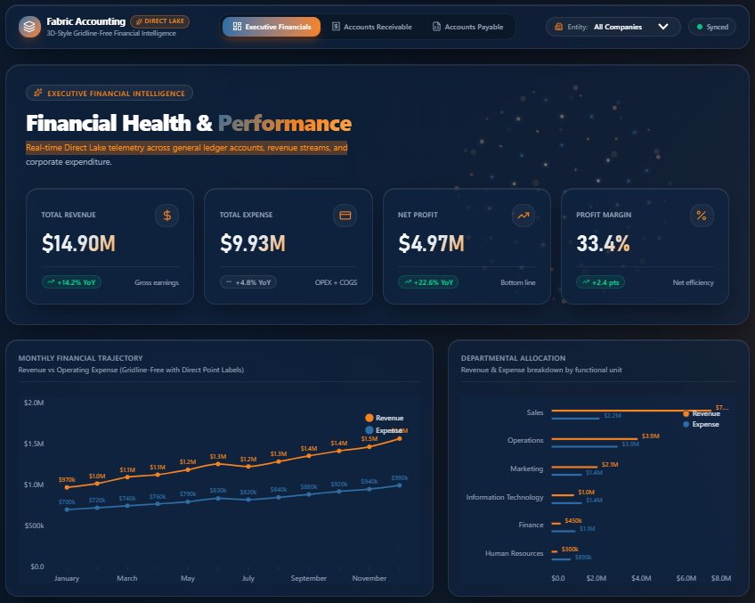
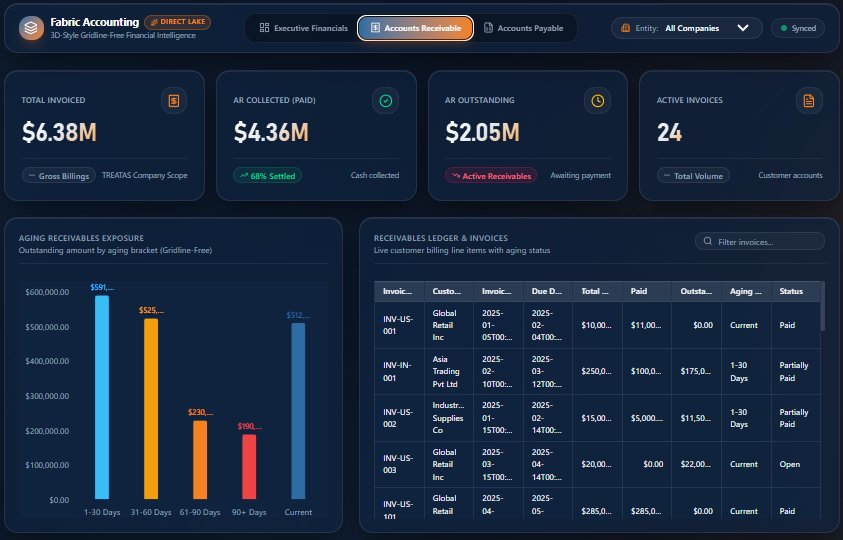
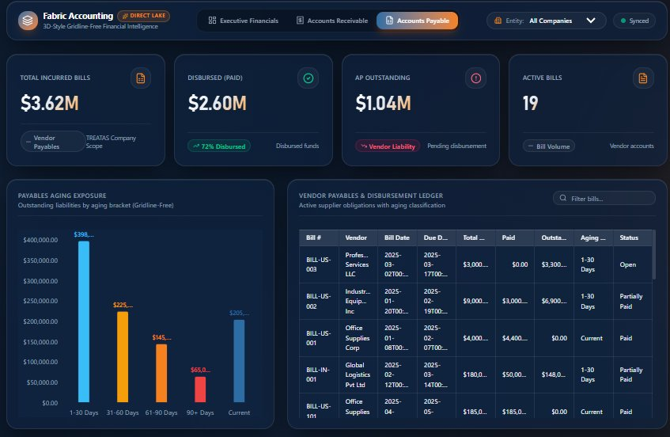

# Client Showcase Presentation — Fabric Accounting (`App Fabric`)

> **Solution:** Enterprise Financial Intelligence Application on **Microsoft Fabric** (OneLake + Fabric Warehouse + DirectLake Semantic Model + Fabric AppBackend)  
> **Repository:** https://github.com/rajgdt1712/Fabric-App-Presentation

---

## 1. Executive Summary & Business Value

**Fabric Accounting (`App Fabric`)** delivers real-time financial intelligence across multiple legal entities (`US Operations`, `UK Operations`, `India Operations`) on a unified Microsoft Fabric foundation:

| Capability | Business Outcome |
| :--- | :--- |
| **DirectLake Analytics** | Zero-copy live telemetry straight from OneLake Delta tables (`Gold_FabricApp.Warehouse`) |
| **Multi-Entity Governance** | Dynamic Row-Level Security (`Finance_RLS`) by Microsoft Entra UPN via `dbo.SecurityUserCompany` |
| **3-Pillar Executive UI** | Unified React + Vega-Lite app covering **Executive Financials**, **Accounts Receivable**, and **Accounts Payable** |
| **Automated CI/CD & Backup** | Full codebase, TMDL model, Warehouse DDLs, CSVs, and OneLake Parquet exported and versioned in GitHub |

---

## 2. Live Solution Showcase

### Executive Financials


### Accounts Receivable


### Accounts Payable


---

## 3. Architecture

```text
ERP / Subledger Data (US01, UK01, IN01)
   └──> Gold_FabricApp.Warehouse (OneLake Delta Tables + T-SQL)
           └──> Fabric App SM.SemanticModel (DirectLake + Finance_RLS)
                   └──> App Fabric.AppBackend (React + Vega-Lite Portal App)
```

---

## 4. Verified Portfolio Metrics (2025 Financial Snapshot)

| Domain | Key Metrics |
| :--- | :--- |
| **Executive Financials** | Total Revenue: `$14.90M` \| Total Expense: `$9.93M` \| Net Profit: `$4.97M` \| Profit Margin: `33.4%` |
| **Monthly & Dept Coverage** | Full 12-month trajectory (`January`–`December 2025`) across 6 departments (`Sales`, `Operations`, `Marketing`, `Information Technology`, `Finance`, `Human Resources`) |
| **Accounts Receivable** | Total Invoiced: `$6.38M` \| Collected: `$4.36M` (`68%`) \| Outstanding: `$2.05M` \| Active Invoices: `24` |
| **Accounts Payable** | Total Incurred Bills: `$3.62M` \| Disbursed: `$2.60M` (`72%`) \| Outstanding: `$1.04M` \| Active Bills: `19` |

---

## 5. How We Overcame Client Requirements & Challenges

1. **Real-Time Analytics Without Scheduled Import Delays:** Connected `Fabric App SM.SemanticModel` to `Gold_FabricApp.Warehouse` via **DirectLake** (`AzureStorage.DataLake`), eliminating data duplication and scheduled import lag.
2. **Dynamic Multi-Entity Security (`Finance_RLS`):** Implemented `dbo.SecurityUserCompany` + `USERPRINCIPALNAME()` RLS on `DimCompany`, `FactAccountsReceivable`, and `FactAccountsPayable`, paired with `TREATAS` measure propagation across company boundaries.
3. **Full-Stack Semantic Model & Star-Schema Alignment:** Fixed 7 reversed `Dim -> Fact` relationships in `relationships.tmdl`, added missing physical alias columns in `Gold_FabricApp.Warehouse` (required for DirectLake compatibility), and implemented missing DAX measures (`Revenue`, `Total Expense`, `Net Profit`, `Profit Margin %`, `Total Invoiced`, `Total Bills`).
4. **Frontend Visualization & Ledger Query Fixes:** Resolved blank Vega-Lite folded charts (`format: "$#,0"` -> `$,.2s`) and fixed `HTTP 400` errors on the AR/AP ledger tables (`TOPN` `[DueDate]` sort column + `CompanyKey` `TREATAS` filter).
5. **Automated GitHub Portability:** Built `export_fabric_app.py` and `export_warehouse_data.ps1` using Fabric REST APIs (`getDefinition`), OneLake DFS, and T-SQL endpoints to overcome `fab export` CLI gaps for `AppBackend` and `Warehouse`.

---

## 6. Live Client Demo Script

1. **Executive Financials:** Highlight `DIRECT LAKE` + `Synced` indicators, walk through `$14.90M` Revenue / `$9.93M` Expense / `$4.97M` Net Profit / `33.4%` Margin, Monthly Trajectory, and Departmental Allocation.
2. **Entity Slicer:** Switch between `All Companies`, `US Operations`, `UK Operations`, and `India Operations` to demonstrate live company scoping.
3. **Accounts Receivable:** Review `$6.38M` invoiced, `68%` settled, 5-bucket Aging Exposure, and live search in **Receivables Ledger & Invoices**.
4. **Accounts Payable:** Review `$3.62M` incurred bills, `72%` disbursed, 5-bucket Payables Aging Exposure, and **Vendor Payables & Disbursement Ledger**.
